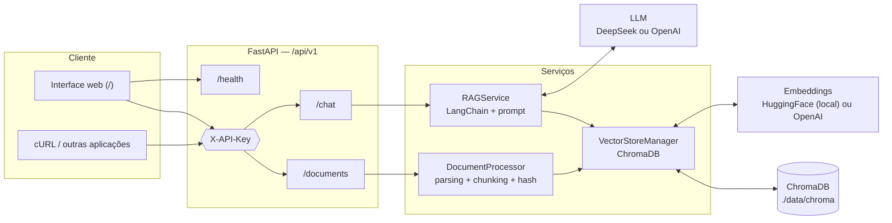

# 🧠 Assistente IA com RAG

> Chat que responde perguntas **com base nos seus próprios documentos** (PDF, TXT, Markdown, CSV, JSON), citando a fonte e a página de cada trecho usado. Backend em FastAPI, orquestração com LangChain e busca vetorial com ChromaDB.

[](https://github.com/SandyMarques/Assistente-IA-com-RAG/actions/workflows/tests.yml)
[](https://www.python.org/)
[](https://fastapi.tiangolo.com/)
[](https://www.langchain.com/)
[](https://www.trychroma.com/)
[](https://www.docker.com/)
[](LICENSE)

---

## 📋 Sumário
- [O problema](#-o-problema)
- [Principais recursos](#-principais-recursos)
- [Arquitetura](#-arquitetura)
- [Como rodar](#-como-rodar)
- [Endpoints da API](#-endpoints-da-api)
- [Interface web](#-interface-web)
- [Segurança](#-segurança)
- [Variáveis de ambiente](#%EF%B8%8F-variáveis-de-ambiente)
- [Testes](#-testes)
- [Estrutura de pastas](#-estrutura-de-pastas)

---

## 🎯 O problema

Encontrar uma informação em dezenas de PDFs, contratos ou manuais costuma ser um trabalho de `Ctrl+F` e leitura manual. Um chat genérico com IA também não resolve: ele não conhece seus documentos e pode inventar respostas.

Este projeto aplica **RAG (Retrieval-Augmented Generation)**:
1. os documentos são divididos em trechos e indexados em um banco vetorial;
2. a cada pergunta, os trechos mais relevantes são recuperados;
3. o modelo de linguagem responde **usando apenas esses trechos** e informa de onde tirou cada parte.

---

## ✨ Principais recursos

- **Ingestão multiformato** — PDF (com número de página), TXT, Markdown, CSV e JSON.
- **Chunking com sobreposição** (`RecursiveCharacterTextSplitter`) e hash SHA-256 para não indexar o mesmo documento duas vezes.
- **Banco vetorial persistente** com ChromaDB.
- **Embeddings locais e gratuitos** por padrão (`sentence-transformers/all-MiniLM-L6-v2`), com opção de usar OpenAI.
- **LLM configurável** — DeepSeek (padrão) ou OpenAI.
- **Prompt contra alucinação** — o modelo é instruído a responder só com base no contexto recuperado e a dizer quando a resposta não está nos documentos.
- **Filtro de relevância** — trechos distantes demais da pergunta são descartados em vez de aparecerem como "fonte".
- **API REST** documentada (Swagger/ReDoc, liberados apenas em desenvolvimento).
- **Interface web embutida** — upload por arrastar e soltar, chat e painel de fontes citadas.
- **Docker e Docker Compose** com volumes persistentes.

---

## 🏗 Arquitetura



**Fluxo de uma pergunta:** pergunta → embedding → busca dos `top_k` trechos mais próximos no ChromaDB → descarte dos trechos pouco relevantes → montagem do prompt com o contexto → resposta do LLM + lista de fontes (arquivo, página, trecho).

---

## 🚀 Como rodar

### Opção A — Docker (recomendado)

```bash
git clone https://github.com/SandyMarques/Assistente-IA-com-RAG.git
cd Assistente-IA-com-RAG
cp .env.example .env
```

Edite o `.env` e preencha pelo menos:
- `DEEPSEEK_API_KEY` (ou `LLM_PROVIDER=openai` + `OPENAI_API_KEY`);
- `API_KEY` — a chave que a interface e os clientes vão enviar no header `X-API-Key`. Gere uma com:
  ```bash
  python -c "import secrets; print(secrets.token_urlsafe(32))"
  ```

```bash
docker compose up --build -d
```

Acesse **http://localhost:8000**, cole a sua `API_KEY` no campo da interface e envie o primeiro documento.

> Os documentos indexados ficam em `./data/chroma`, mapeado como volume: eles continuam lá depois de reiniciar o container.

### Opção B — Python local

Requer Python 3.10 ou superior.

```bash
git clone https://github.com/SandyMarques/Assistente-IA-com-RAG.git
cd Assistente-IA-com-RAG
python -m venv venv
```

Ative o ambiente virtual:
- Linux/macOS: `source venv/bin/activate`
- Windows (PowerShell): `.\venv\Scripts\Activate.ps1`

```bash
pip install -r requirements.txt
cp .env.example .env   # e preencha as chaves, como na opção A
uvicorn app.main:app --reload --host 127.0.0.1 --port 8000
```

Para ver a documentação interativa em `/docs` e `/redoc`, use `EXPOSE_DOCS=true` no `.env` (apenas em desenvolvimento).

---

## 📡 Endpoints da API

Todas as rotas de dados exigem o header `X-API-Key`. Só `/health` é aberta.

| Método | Rota | Descrição |
| :--- | :--- | :--- |
| `GET` | `/api/v1/health` | Status da aplicação e do banco vetorial. |
| `POST` | `/api/v1/documents/upload` | Envia, processa e indexa um arquivo. |
| `GET` | `/api/v1/documents` | Lista os documentos indexados e a quantidade de trechos de cada um. |
| `DELETE` | `/api/v1/documents/{filename}` | Remove um documento da base. |
| `DELETE` | `/api/v1/documents` | Limpa toda a base vetorial. |
| `POST` | `/api/v1/chat` | Faz uma pergunta e recebe a resposta com as fontes. |

### Exemplos

```bash
# Enviar um documento
curl -X POST "http://localhost:8000/api/v1/documents/upload" \
  -H "X-API-Key: $API_KEY" \
  -F "file=@contrato.pdf"
```

```bash
# Perguntar
curl -X POST "http://localhost:8000/api/v1/chat" \
  -H "X-API-Key: $API_KEY" \
  -H "Content-Type: application/json" \
  -d '{"query": "Qual é o prazo de vigência do contrato?", "history": [], "top_k": 4}'
```

Formato da resposta (valores ilustrativos):

```json
{
  "answer": "Segundo o contrato.pdf (página 2), a vigência é de ...",
  "sources": [
    { "content": "Trecho recuperado...", "source": "contrato.pdf", "page": 2, "chunk_id": 3 }
  ],
  "sources_count": 1,
  "model_used": "deepseek-chat",
  "execution_time_ms": 0
}
```

---

## 💻 Interface web

Disponível em `http://localhost:8000/`:

- **Painel lateral** — campo da chave de API (guardada só no navegador), upload por arrastar e soltar, lista de documentos indexados com exclusão individual e indicador de status.
- **Chat** — respostas em Markdown, `Shift+Enter` para quebrar linha e painel retrátil **"Fontes citadas"** para conferir de onde veio cada resposta.

---

## 🔒 Segurança

- **Autenticação por chave** (`X-API-Key`, comparação em tempo constante). Se `REQUIRE_API_KEY=true` e nenhuma `API_KEY` estiver definida, a API **recusa** as requisições em vez de ficar aberta.
- **CORS restrito** a origens configuradas — nunca `*`.
- **Swagger/ReDoc desligados** por padrão fora de desenvolvimento.
- **Limites de recurso** — tamanho máximo de upload, teto de contexto, timeout e teto de tokens do LLM.
- **Validação de entrada** — o histórico do chat não aceita o papel `system` e tem limite de itens e de tamanho.
- **Nenhum segredo versionado** — tudo vem do `.env`, que está no `.gitignore`.

---

## ⚙️ Variáveis de ambiente

A lista completa, comentada, está no [`.env.example`](.env.example). As principais:

| Variável | Padrão | Descrição |
| :--- | :--- | :--- |
| `LLM_PROVIDER` | `deepseek` | `deepseek` ou `openai`. |
| `DEEPSEEK_API_KEY` | — | Chave da DeepSeek ([obter](https://platform.deepseek.com/)). |
| `DEEPSEEK_MODEL` | `deepseek-chat` | Modelo DeepSeek. |
| `OPENAI_API_KEY` | — | Chave da OpenAI (se usar OpenAI para LLM ou embeddings). |
| `OPENAI_MODEL` | `gpt-4o-mini` | Modelo OpenAI. |
| `EMBEDDING_PROVIDER` | `huggingface` | `huggingface` (local, gratuito) ou `openai`. |
| `EMBEDDING_MODEL` | `sentence-transformers/all-MiniLM-L6-v2` | Modelo de embeddings. |
| `API_KEY` | — | Chave exigida no header `X-API-Key`. |
| `REQUIRE_API_KEY` | `true` | Exigir a chave. Use `false` apenas localmente. |
| `CORS_ORIGINS` | `localhost:8000` | Origens permitidas. |
| `EXPOSE_DOCS` | `false` | Expor `/docs`, `/redoc` e `/openapi.json`. |
| `CHUNK_SIZE` / `CHUNK_OVERLAP` | `1000` / `200` | Tamanho e sobreposição dos trechos. |
| `TOP_K_RESULTS` | `4` | Trechos recuperados por pergunta. |
| `MIN_RELEVANCE_DISTANCE` | `1.5` | Distância máxima aceita para um trecho contar como fonte. |
| `MAX_UPLOAD_BYTES` | `26214400` | Tamanho máximo de upload (25 MB). |

---

## 🧪 Testes

A suíte usa **pytest** com *test doubles* determinísticos (embeddings falsos e LLM simulado) e um ChromaDB temporário por teste: roda **offline**, sem chave de API e sem custo. Ela também roda a cada push via GitHub Actions.

```bash
pytest -v
```

Com cobertura:

```bash
pytest --cov=app tests/
```

---

## 📁 Estrutura de pastas

```
Assistente-IA-com-RAG/
├── app/
│   ├── main.py                  # FastAPI, CORS, rotas e arquivos estáticos
│   ├── core/
│   │   ├── config.py            # Configurações (Pydantic Settings)
│   │   ├── logging.py           # Logging padronizado
│   │   └── security.py          # Autenticação por X-API-Key
│   ├── schemas/                 # Modelos Pydantic (chat, documentos, health)
│   ├── services/
│   │   ├── document_processor.py# Extração de texto e chunking
│   │   ├── vector_store.py      # Operações no ChromaDB
│   │   └── rag_service.py       # Cadeia RAG e prompt
│   ├── api/v1/endpoints/        # chat.py, documents.py, health.py
│   └── static/                  # Interface web (HTML, CSS, JS)
├── tests/                       # Suíte pytest (offline)
├── Dockerfile
├── docker-compose.yml
├── requirements.txt
├── pyproject.toml
└── .env.example
```

---

## 👤 Autor

**Talyson Marques** — [Portfólio](https://sandymarques.github.io/talyson-projects/) · [LinkedIn](https://www.linkedin.com/in/talysonmarques/) · [GitHub](https://github.com/SandyMarques)

Distribuído sob a licença [MIT](LICENSE).
