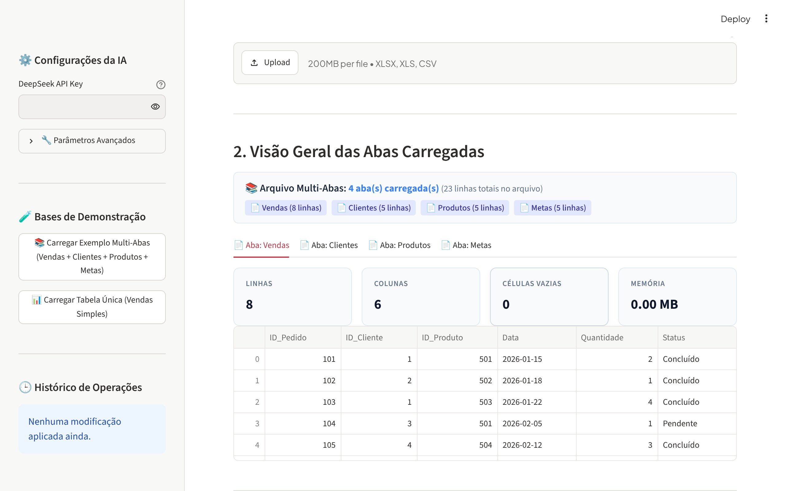
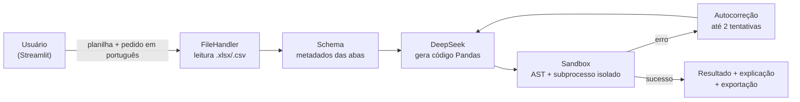

# 📊 Automatizador de Planilhas com IA

> Manipule planilhas Excel e CSV **escrevendo em português o que você quer fazer**. A IA gera o código Pandas, executa em um sandbox isolado, corrige sozinha os próprios erros e devolve a planilha pronta para baixar.

[](https://github.com/SandyMarques/Automatizador-de-Planilhas-com-IA/actions/workflows/tests.yml)
[](https://www.python.org/)
[](https://streamlit.io/)
[](https://pandas.pydata.org/)
[](https://www.deepseek.com/)
[](LICENSE)

<p align="center">
  
  <br><sub>Interface do projeto, com a base de demonstração carregada.</sub>
</p>

---

## 🎯 O problema

Filtrar, cruzar abas (PROCV), agrupar e calcular colunas em planilhas é trabalho repetitivo, e depende de saber fórmulas ou programar. Com esta ferramenta, basta escrever, por exemplo:

> *"Agrupe por Categoria, some a Quantidade, calcule a média do Preço e ordene pelo total decrescente."*

A aplicação mostra o resultado, explica em português o que foi feito e permite desfazer.

---

## ✨ Funcionalidades

- **Planilhas com várias abas** — lê todas as abas de um `.xlsx` e permite cruzar dados entre elas (merges, PROCV, consolidações).
- **CSV inteligente** — detecta delimitador (`,` `;` tab) e encoding (`utf-8`, `latin-1`, `cp1252`).
- **Código gerado por IA** — DeepSeek (`deepseek-chat` ou `deepseek-reasoner`), por API compatível com OpenAI.
- **Autocorreção** — se o código gerado falhar, a IA recebe o erro e tenta corrigir (até 2 tentativas).
- **Histórico** — aplique transformações em sequência, use **Desfazer** ou **Resetar** para a planilha original.
- **Visualização** — métricas da planilha, resumo do impacto de cada operação e gráficos (barras, linhas, área).
- **Exportação** — `.xlsx` (mantendo as abas) e `.csv` (`utf-8-sig`, abre corretamente no Excel).
- **Base de demonstração** — um exemplo com várias abas (Vendas, Clientes, Produtos, Metas) carregado com um clique.

---

## 🛡️ Sandbox de execução

Executar código gerado por um modelo de linguagem é arriscado, então ele **nunca roda no processo da aplicação**. As camadas de proteção, na ordem em que atuam:

1. **Análise estática (AST)** — bloqueia imports fora da lista (`pandas`, `numpy`, `datetime`, `math`, `statistics`, `re`, `json`), atributos `__dunder__`, `eval`/`exec`/`open`/`getattr`/`compile` e funções de leitura/escrita do pandas. Diferente de uma lista de palavras proibidas, não é enganada por concatenação de strings.
2. **Subprocesso isolado** — diretório temporário vazio e nenhuma variável de ambiente da aplicação (a chave de API não existe lá dentro).
3. **Builtins restritos** — sem `open`, `eval`, `exec`, `__import__`, `input` ou introspecção.
4. **Audit hook** — barreira em tempo de execução contra rede, criação de processos, `ctypes` e escrita em disco.
5. **Limites de recurso** — timeout sempre ativo; em Linux/macOS, também limite de CPU, de arquivos e de processos.
6. **Entrada imutável** — os dados vão para o subprocesso serializados; o código só consegue devolver dados novos.

Cada camada tem testes próprios em `tests/test_security_sandbox.py` e `tests/test_code_executor.py`.

---

## 🚀 Como rodar

Requer Python 3.10 ou superior e uma chave da [DeepSeek](https://platform.deepseek.com/).

```bash
git clone https://github.com/SandyMarques/Automatizador-de-Planilhas-com-IA.git
cd Automatizador-de-Planilhas-com-IA
python -m venv venv
```

Ative o ambiente virtual:
- Linux/macOS: `source venv/bin/activate`
- Windows (PowerShell): `.\venv\Scripts\Activate.ps1`

```bash
pip install -r requirements.txt
cp .env.example .env
```

Preencha `DEEPSEEK_API_KEY` no `.env` (ou informe a chave na barra lateral da aplicação) e rode:

```bash
streamlit run app.py
```

A aplicação abre em `http://localhost:8501`.

---

## 💡 Exemplos de comandos

- *"Crie uma coluna Valor_Total multiplicando Quantidade por Preco_Unitario."*
- *"Filtre os registros com Status igual a 'Concluído' e Região 'Sudeste'."*
- *"Traga o nome do cliente da aba Clientes para a aba Vendas usando o ID_Cliente."*
- *"Crie uma coluna de comissão de 5% para as vendas acima de R$ 1.000."*
- *"Remova as linhas com valores vazios e formate as datas como dd/mm/aaaa."*

---

## 🏗️ Arquitetura



```
Automatizador-de-Planilhas-com-IA/
├── app.py                    # Aplicação Streamlit
├── src/
│   ├── core/
│   │   ├── config.py         # Configurações e parâmetros da DeepSeek
│   │   └── file_handler.py   # Leitura e exportação de CSV/XLSX
│   ├── llm/
│   │   ├── client.py         # Cliente DeepSeek (compatível com OpenAI)
│   │   ├── prompts.py        # Prompts de geração e de autocorreção
│   │   └── schema.py         # Extração de metadados dos DataFrames
│   ├── engine/
│   │   ├── code_executor.py  # Sandbox de execução
│   │   └── error_recovery.py # Ciclo de autocorreção
│   └── ui/                   # Componentes visuais e estilos
└── tests/                    # Suíte pytest (offline)
```

---

## 🧪 Testes

A suíte roda **offline** (o LLM é simulado) e cobre leitura de arquivos, extração de schema, sandbox, autocorreção, estado da aplicação e componentes de interface. Ela também roda a cada push via GitHub Actions.

```bash
python -m pytest -v
```

---

## 👤 Autor

**Talyson Marques** — [Portfólio](https://sandymarques.github.io/talyson-projects/) · [LinkedIn](https://www.linkedin.com/in/talysonmarques/) · [GitHub](https://github.com/SandyMarques)

Distribuído sob a licença [MIT](LICENSE).
